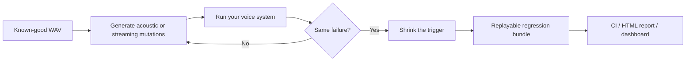

# VoiceShrink

**Delta debugging for voice systems: find the smallest audio or streaming change that breaks your pipeline, then save it as a replayable regression test.**

[](https://www.python.org/)
[](LICENSE)
[](https://github.com/AustinYli/voiceshrink/actions/workflows/ci.yml)
[](https://github.com/AustinYli/voiceshrink/releases/tag/v0.2.6)

You give VoiceShrink a WAV file that your system handles correctly. It tries acoustic and streaming mutations until something fails, checks that the failure repeats, shrinks the mutation down, and saves a bundle with the audio, outputs, metadata, file hashes, and an HTML report.

The target can be an ASR model, a voice agent, a speech pipeline, or an audio API, called through a Python function, a command, or an HTTP endpoint. Search and shrinking run locally; your target adapter decides where the audio goes.



## Features

| Feature | What it does |
| --- | --- |
| Failure search | Silence, dropout, noise, gain, clipping, speed, bandwidth, resampling, codec, quantization, packet loss, jitter, delay, and reorder |
| Shrinking | Cuts down operations, duration, location, and strength while keeping the same failure |
| Targets | Python functions, commands, HTTP services, streaming adapters, and an optional local faster-whisper adapter |
| Saved bundles | Clean and minimized audio, scenario, mutation program, observations, metrics, report, and a SHA-256 manifest |
| CI replay | JSON or JUnit output; fails while the bug still reproduces, passes once it's fixed |
| Investigate mode | Cuts an already-failing recording down to a short window that still fails |

## Quick demo

Needs Python 3.10+ and NumPy.

```bash
python -m pip install https://github.com/AustinYli/voiceshrink/releases/download/v0.2.6/voiceshrink-0.2.6-py3-none-any.whl
voiceshrink init demo
voiceshrink baseline demo/demo-scenario.json
voiceshrink discover demo/demo-scenario.json
voiceshrink test --root demo/.voiceshrink/regressions
```

The demo target has a planted bug: a pause of about 500 ms changes an order ID. `discover` finds it, shrinks it, and saves `base.wav`, `minimal.wav`, the mutation program, observations, metadata, and an HTML report under `demo/.voiceshrink/regressions/`.

There are two more demos, for streaming and investigate mode:

```bash
voiceshrink init-stream stream-demo
voiceshrink discover stream-demo/stream-scenario.json

voiceshrink init-investigate investigate-demo
voiceshrink investigate investigate-demo/investigate-scenario.json
```

`test` exits nonzero while the saved failure still reproduces and passes once the target is fixed. Use `--fresh` after changing the target code or model so cached results aren't reused.

Each finding is saved as a folder you can archive or keep with your test fixtures:

```text
.voiceshrink/regressions/<finding>/
├── base.wav
├── minimal.wav
├── mutation.json
├── scenario.json
├── expected.json
├── observed.json
├── metadata.json
├── integrity.json
└── report.html
```

## Connect a voice system

Put a scenario file next to a known-good 16-bit PCM WAV. JSON and simple nested YAML (mappings and lists) work out of the box; install `voiceshrink[yaml]` for full YAML.

```yaml
name: order-number
audio: fixtures/order_74821.wav
expected:
  tool:
    name: lookup_order
  arguments:
    order_id: "74821"
target:
  type: command
  command: [python, my_agent_test.py, "{audio}"]
  timeout: 60
  fingerprint: my-agent-v1
oracle:
  equivalence: same_category
search:
  max_runs: 200
  max_concurrency: 4
  max_failures: 3
  cost_per_run: 0.002
  cost_currency: USD
  families: [silence, dropout, noise, gain, clipping, speed, bandwidth, resample, codec, quantize]
evaluation:
  baseline_trials: 3
  trials: 3
  failure_threshold: 1.0
```

The command gets the candidate WAV path and prints one JSON value to stdout, for example:

```json
{"tool":"lookup_order","arguments":{"order_id":"74821"}}
```

The target can also print `{"final_output": ..., "stages": [{"name": "asr", "output": ...}]}`. The report then shows the first stage where the output differs from the clean run. `expected` checks the named fields and ignores extra ones. `expected.transcript_contains` checks for a substring. `expected.equals` compares the whole output.

### Interventions

If your system can swap in a stage's output while keeping the failing audio and the rest of the pipeline, VoiceShrink runs one intervention after shrinking. It replaces the first diverging stage with its known-good output and records whether that fixes the result.

- Python: add `intervention_callable: "my_module:intervene"`. It receives `(audio_path, scenario, stage_name, known_good_output)`.
- Command: add `intervention_command`. It receives `{"stage": ..., "replacement": ...}` on stdin and prints a target result as JSON.
- HTTP: add `intervention_url`. It receives JSON with `audio_base64`, `stage`, and `replacement`.

If the intervention fixes the output, that stage is likely part of the cause. It isn't proof of a root cause.

### Streaming transport faults

Streaming targets get a plan of PCM chunks. Acoustic mutations are applied first, then transport mutations change how chunks are delivered without touching the WAV. Transport families: `packet_loss`, `jitter`, `chunk_delay`, and `reorder`.

```yaml
target:
  type: python
  callable: my_target:run_file
  stream_callable: my_target:run_stream
streaming:
  enabled: true
  chunk_ms: 20
search:
  families: [packet_loss, jitter, chunk_delay, reorder]
```

The Python stream function receives `(stream_plan, scenario)`. `stream_plan.chunks` holds sequence numbers, original timestamps, delivery timestamps, drop state, and base64 16-bit PCM. `stream_plan.delivered` returns the chunks that weren't dropped, in delivery order.

- Command targets use `stream_command`; the stream plan arrives as JSON on stdin.
- HTTP targets use `stream_url`; the stream plan is POSTed as JSON.

Saved streaming regressions include `stream-plan.json` and a transport summary. The plan only describes delivery timing; your adapter decides whether to replay it in real time or on a virtual clock.

### Other adapters

- **Python:** `target: {type: python, callable: "my_module:run"}`. The function receives `(audio_path, scenario)` and returns a `TargetResult`, a structured result, or the final output. Modules next to the scenario can be imported without installing them. Subclass `voiceshrink.Target` for a reusable adapter.
- **HTTP:** `target: {type: http, url: "http://localhost:8000/test-voice"}`. VoiceShrink POSTs the raw WAV bytes with `Content-Type: audio/wav` and expects JSON back.
- **Command:** Pass a list of arguments if you can; a single command string also works. `{audio}` is replaced with the absolute path to the candidate WAV.

Keep credentials out of scenario files by reading them from environment variables:

```yaml
target:
  type: http
  url: https://staging.example.test/voice
  headers_env:
    Authorization: VOICE_TEST_AUTHORIZATION
```

Command targets support `environment_from`, which maps a child-process variable to a host variable, and `environment` for plain non-secret values.

### Local ASR with faster-whisper

Install the optional adapter and point a scenario at a local faster-whisper model:

```bash
python -m pip install -e ".[asr]"
```

```yaml
expected:
  transcript_contains: "seven four eight two one"
target:
  type: faster-whisper
  model: tiny.en
  device: cpu
  compute_type: int8
  language: en
  fingerprint: faster-whisper-tiny-en
```

The first run may download the model. The core package never imports the ASR adapter.

`real-asr-demo/` has a finished example. With faster-whisper installed:

```bash
voiceshrink baseline real-asr-demo/jfk-scenario.json
voiceshrink discover real-asr-demo/jfk-scenario.json
voiceshrink test --root real-asr-demo/.voiceshrink/regressions
```

With `tiny.en` on CPU, background noise at 29 dB SNR changed the transcript from "ask not what your country can do for you" to "asked not what your country can do for you". The saved regression replays offline once the model is cached.

A discovery run can call your target many times. Point it at staging, dry-run tool calls, or mocks if the target can book, delete, transfer, or send anything.

## Failure matching and limits

The clean input has to pass every baseline trial. A candidate counts as failing when the share of trials with the **same failure** reaches `evaluation.failure_threshold`. `oracle.equivalence` can be `same_category` (default: same component, category, and field path), `exact` (same observed value), or `custom` with `oracle.callable: "module:function"`, which takes two `FailureFingerprint` objects.

Search tries single mutations at several strengths, then at more positions in the audio, then pairs. Shrinking removes operators, narrows the affected region, and tries weaker strengths. It doesn't assume failures get worse as strength goes up. `search.max_runs` caps real target calls across baseline, discovery, and shrinking; cached results don't count. The result is the smallest failing mutation found within the budget, not a guaranteed global minimum.

Positions in time come from fixed start, middle, and end points plus speech/quiet transitions and quiet-gap midpoints detected in the clean audio. The number of positions is capped so run counts stay predictable.

`search.max_pairs` controls pairwise search. Combinations of three or more mutations are off by default because they can use a lot of target calls:

```yaml
search:
  max_combinations: 40
  combination_size: 3
  seed: 10999
```

These combinations use different mutation families and seeded sampling, so the same scenario and seed give the same candidate order.

`search.max_failures` lets a run keep going after the first finding. Two failures count as different according to the oracle's equivalence mode, and each one gets its own minimized bundle.

Results are cached in SQLite, keyed by the base audio, mutation program, target config, expected behavior, oracle, and trial count. Set `target.fingerprint` when the model, prompt, or config changes, or pass `--fresh`.

Repeated trials run on up to `search.max_concurrency` workers. Keep it at `1` for Python targets that aren't thread safe.

Command adapters apply `target.timeout` to file, streaming, and intervention calls and report a timeout error when it's hit. Invalid or corrupt WAV files are rejected before discovery starts.

### Report privacy

The local bundle keeps the full outputs so it can be replayed. The HTML report can hide outputs and audio players:

```yaml
privacy:
  redact_report_outputs: true
  hide_report_audio: true
  cache_results: false
```

The first two settings only affect the HTML report; the JSON and WAV files in the bundle are unchanged. Set `cache_results: false` to keep target outputs out of the SQLite cache. Repeated searches will then call the target more often.

## Investigate an existing failure

Investigate mode takes audio that already fails and looks for a short window of it that fails the same way:

```yaml
name: failed-customer-call
audio: failed-call.wav
expected:
  transcript_contains: "74821"
target:
  type: command
  command: [python, my_agent_test.py, "{audio}"]
search:
  max_runs: 200
investigate:
  min_window_ms: 250
  boundary_step_ms: 10
```

```bash
voiceshrink investigate failed-scenario.yaml
```

The bundle in `.voiceshrink/investigations/` has the original and cropped WAV files, the crop program, target outputs, metadata, and an HTML report. There's no clean reference in this mode, so the result is just the shortest failing window found. The cut audio may still have mattered, and the window isn't necessarily the root cause.

## CLI

```text
voiceshrink init [directory]
voiceshrink init-stream [directory]
voiceshrink init-investigate [directory]
voiceshrink baseline scenario.yaml [--fresh]
voiceshrink discover scenario.yaml [--fresh]
voiceshrink investigate scenario.yaml [--fresh]
voiceshrink validate scenario.yaml [--json]
voiceshrink test [--root path] [--fresh]
voiceshrink report issue-name [--root path]
voiceshrink verify path/to/artifact [--json]
voiceshrink dashboard [--root .voiceshrink]
voiceshrink doctor [--scenario scenario.yaml] [--json]
```

`discover` and `investigate` take `--json` and print one result object for CI or scripts. `validate` checks the config, audio format, mutation families, and streaming adapter without calling the target.

Scenarios are validated before anything runs. Bad target settings, URLs, budgets, concurrency, costs, mutation families, thresholds, streaming or investigate settings, oracle modes, and privacy values are rejected. `voiceshrink --version` prints the version.

Every bundle has an `integrity.json` with SHA-256 hashes and file sizes. `verify` reports missing or changed files. `dashboard` writes `index.html` and `dashboard.json` listing every bundle under a `.voiceshrink` folder with its mutation program, reproduction rate, and integrity status.

The integrity file catches accidental changes; it isn't a signature. Only replay bundles from sources you trust, because `voiceshrink test` runs the target named in each saved scenario.

For CI, `test` takes `--json` and `--junit results.xml`. A regression that still reproduces is a JUnit failure and the command exits nonzero. One that no longer reproduces is reported as resolved. `doctor` checks Python, NumPy, the optional YAML and ASR packages, workspace access, and optionally a scenario, without running the target.

If a target has a known per-call price, set `search.cost_per_run`. Bundles then record the estimated cost, currency, search time, number of runs, and cached results.

## Scope

VoiceShrink has Discover mode, Investigate mode, local PCM WAV mutations, simulated streaming faults, Python/command/HTTP adapters, structured output checks, concurrent repeated trials, caching, three-phase shrinking, regression replay, stage traces, optional interventions, an optional faster-whisper adapter, and static HTML reports. The `codec` family simulates an 8-bit μ-law round trip and doesn't call an external encoder. Without an intervention, a stage trace only shows where outputs first differ.

Run the tests with `python -m unittest discover -s tests -v`.

## Status

The current release is v0.2.6. Finished milestones are in [ROADMAP.md](ROADMAP.md) and release notes are in [CHANGELOG.md](CHANGELOG.md).

## Contributing

Bug reports, new target adapters, new deterministic mutation families, and doc fixes are welcome. Read [CONTRIBUTING.md](CONTRIBUTING.md) first. Report security issues as described in [SECURITY.md](SECURITY.md).

VoiceShrink is released under the [MIT License](LICENSE).

## Downloads

The [v0.2.6 release](https://github.com/AustinYli/voiceshrink/releases/tag/v0.2.6) has the wheel, source archive, and SHA-256 checksums.
